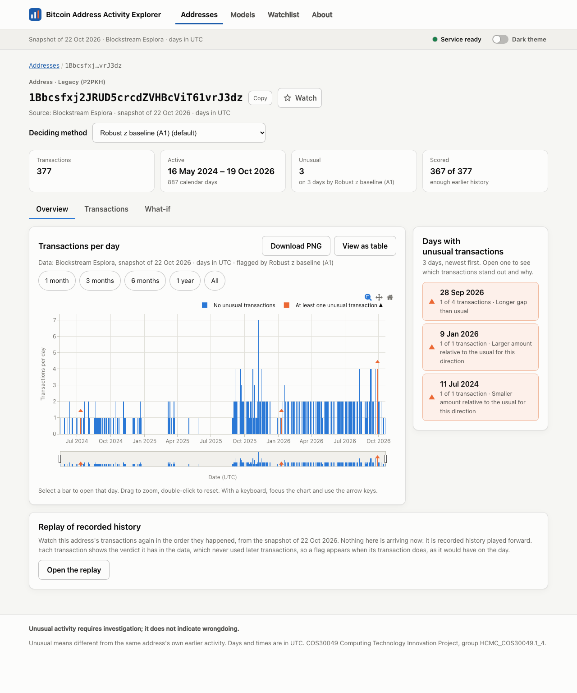

# Bitcoin Address Activity Explorer

COS30049, Assignment 3. A web application that shows, for a Bitcoin address, which of its transactions were
unusual for **that address's own history**: a React front end over a FastAPI service that wraps Assignment 2's
`Predictor` (nine scoring methods over a frozen snapshot of 28 addresses, 22 October 2026). A flag means
*unusual compared with the address's usual activity* and nothing more: the application never says why an
address behaves as it does, and every flagged item carries the line "Unusual activity requires investigation;
it does not indicate wrongdoing." You can open an address, see its day-by-day activity, list and filter its
transactions, read the plain-language reasons for one transaction, try a what-if amount, compare the methods
and export what the table shows.



> **Status.** Commands in a plain code block were run on macOS (Apple silicon, Python 3.11.18, Node v24) while
> writing this file. Where a command was not run, or only part of it was, the line says so. Nothing here has been
> run on Windows yet (the team's Windows clean install is on 29 November).

Contents: [Folders](#what-is-in-the-repository) · [What you need](#what-you-need) · [Back end](#1-start-the-back-end) ·
[Front end](#2-start-the-front-end) · [Check it works](#3-check-it-works) · [Tour](#4-a-two-minute-tour) ·
[API](#the-api) · [Model and configuration](#how-the-model-is-integrated-and-configured) · [Tests](#tests) ·
[Troubleshooting](#troubleshooting) · [Libraries, licences, AI use](#libraries-and-licences)

## What is in the repository

| Folder | What it holds |
|---|---|
| `backend/` | The FastAPI service (`app/`), Assignment 2's runtime copied unchanged (`explorer/`, `lm/`, `models/`, `data/`, `reports/`), `config/settings.json`, `openapi.json`, the tests, `MODIFICATIONS.md` (every change made for the web) |
| `frontend/` | The React + TypeScript application (Vite), its unit tests (`tests/`), browser tests (`e2e/`) and the type generator (`tools/typegen/`) |
| `shared/` | Test vectors read by both tiers (`address_vectors.json`, `whatif_vectors.json`) |
| `tools/` | `vendor_a2.py` (copies Assignment 2's runtime in, with a SHA-256 for every file), `precompute_assistant.py` (the Assistant's prepared answers), `ms_gate_check.py` and `measure.py` (checks and measurements used while building) |
| `docs/` | The delivery plan (`plan/`), the brief, screenshots, the work log (`WORKLOG.md`) and the AI use log (`AI_USE_LOG.md`) |
| `LICENSES.md` | The licence of every library the project uses |

## What you need

- Windows 10 or 11, or macOS on Apple silicon (Linux should work and has not been tried). No GPU.
- About 2 GB of free disk is enough. Measured here: the back end's conda environment about 0.9 GB (PyTorch, about
  0.35 GB of it, is installed here but needed only for the optional Assistant), `backend/` 43 MB, the front end's
  `node_modules` about 160 MB. The optional Assistant weights add 610 MB, and the optional browser tests download about
  1 GB of browsers once.
- **conda** (Miniforge or Miniconda) for the back end's Python 3.11 environment.
- **Node.js 22 or later** (`frontend/package.json` says `"node": ">=22"`; the checks on GitHub use Node 24), with npm.
- Optional: the Explorer Assistant (its weights, 610 MB, and PyTorch); see "The optional Assistant" below. Without it every explanation is the template text.

## 1. Start the back end

### macOS

```bash
cd backend
conda env create -f environment.yml     # about a minute or two; run here as --dry-run only (the environment already existed): the solve succeeded
conda activate cos30049-a3
python --version                        # Python 3.11.x
python -m pytest -q                     # optional, about 2 minutes: expect all passed ("-m 'not slow'" is quicker)
uvicorn app.main:app --port 8000        # expect: "Explorer ready: 28 addresses, 9 methods"
```

It is ready about one second after the start. Leave this terminal open.

If `conda activate` is not recognised in a new terminal, run `conda init zsh` once and open a new terminal
(not run here; the hook was loaded with `eval "$(conda shell.zsh hook)"` instead).

### Windows 10/11 (not run on Windows)

Use the *Miniforge Prompt* or *Anaconda Prompt* for the back end.

```bat
cd backend
conda env create -f environment.yml
conda activate cos30049-a3
set PYTHONUTF8=1
uvicorn app.main:app --port 8000
```

The commands are the same as on macOS; `set PYTHONUTF8=1` is the plan's remedy for a text-encoding message on
Windows. **None of this block has been run on Windows.**

### Without conda

On Python 3.11, `pip install -r requirements.txt` (from `backend/`) installs the same pinned set (this is the route
the GitHub checks use; `environment.yml` is the route tested by hand). The pins are Assignment 2's exact library
versions, because the saved models are pickles and a different scikit-learn warns on every load.

## 2. Start the front end

In a second terminal:

```bash
cd frontend
npm ci
npm run dev                             # then open http://localhost:5173
```

`npm ci` installs exactly what `package-lock.json` pins; `npm install` also works but may change the lock file.
It also installs the small type generator in `frontend/tools/typegen` (a workspace); nothing you see depends on it,
it is only used by `npm run types`. It was run on this Mac and finished with exit code 0.

Vite hands every `/api` request to Uvicorn on port 8000, so the browser sees one origin and needs no
configuration (decision D-A3-11).

## 3. Check it works

1. With the back end running, open <http://localhost:8000/api/health> (or `curl http://localhost:8000/api/health`).
   It answers with the service's state; checked on this Mac on a server started on another port:

   ```json
   {"status":"ok","version":"0.1.0","snapshotDate":"2026-10-22","addressCount":28,"methodCount":9,"assistant":"not_installed","liveLookup":false,"uptimeSeconds":3.9}
   ```

   `uptimeSeconds` differs, and `assistant` is `ready` when the optional weights are installed. For the first second
   the answer is `503` "The explorer service is still starting."
2. Open <http://localhost:5173> and pick the **first address** in the list (the running example,
   `1Bbcsfxj2JRUD5crcdZVHBcViT61vrJ3dz`).
3. You should see its **activity overview**: a chart of transactions per day with the unusual days marked, as in the
   screenshot at the top of this file (`docs/screenshots/05-timeline.png`), and the list of flagged days beside it.
4. `curl http://localhost:5173/api/health` gives the same answer as step 1, through Vite's proxy.

## 4. A two-minute tour

The journey of the demonstration video, with the running example address `1Bbcsfxj2JRUD5crcdZVHBcViT61vrJ3dz`.

1. **Addresses** (the opening screen). Pick the first address, or paste the example into the box; a malformed address gets a message that says what is wrong.
2. **Overview** tab ("Address activity"). Read the day-by-day chart; use the method menu to see another method's marks; click a day listed under "Days with unusual transactions".
3. **Transactions** tab. Use the Status chips to show only the unusual ones and sort by amount; the chart and table select together. "Export" offers a CSV or JSON of what the table shows.
4. **Transaction details.** Open an unusual transaction: its plain-language reasons, the facts, and each of the nine methods' verdicts.
5. **What-if** tab ("Try an amount"). Type amount **0.05** BTC, direction **out**, time `2026-10-20T12:00:00Z`, and submit. The verdict from every method appears, with a chart of how the score moves with the amount.
6. **Models** ("Models and limits"). Compare the nine methods and their test results; then star an address (back on Addresses) to keep it on the **Watchlist**.

The what-if can also be tried by hand (quote any URL that contains `?`, which zsh would otherwise treat as a pattern):

```bash
curl http://localhost:8000/api/addresses
curl http://localhost:8000/api/addresses/1Bbcsfxj2JRUD5crcdZVHBcViT61vrJ3dz/timeline
curl -X POST http://localhost:8000/api/addresses/1Bbcsfxj2JRUD5crcdZVHBcViT61vrJ3dz/what-if \
     -H "Content-Type: application/json" \
     -d '{"amountBtc": 0.05, "direction": "out", "time": "2026-10-20T12:00:00Z"}'      # "scored":true,"flagged":true,"score":5.97...
```

In the Windows Command Prompt the body needs double quotes with the inner quotes escaped (not run on Windows):

```bat
curl -X POST http://localhost:8000/api/addresses/1Bbcsfxj2JRUD5crcdZVHBcViT61vrJ3dz/what-if -H "Content-Type: application/json" -d "{\"amountBtc\": 0.05, \"direction\": \"out\", \"time\": \"2026-10-20T12:00:00Z\"}"
```

## The API

With the back end running, **<http://localhost:8000/docs>** lists every endpoint with its parameters, its answers and
each error status, and can send a request from the browser. The table below is the committed schema
`backend/openapi.json` (regenerate it after changing a route with `python -m app.core.openapi`, from `backend/`).

| ID | Method and path | Purpose | Main statuses |
|---|---|---|---|
| E1 | GET `/api/health` | Ready or starting; what is loaded | 200, 503 |
| E2 | GET `/api/config` | Snapshot, limits, thresholds, names, capabilities | 200, 304 |
| E3 | GET `/api/addresses` | The addresses that can be opened, with counts | 200, 304, 400 |
| E4 | POST `/api/lookup` | Whether a typed address is supported | 200, 400, 404 |
| E5 | GET `/api/addresses/{address}/timeline` | Per-day counts, totals, range, history status | 200, 304, 400, 404 |
| E6 | GET `/api/addresses/{address}/transactions` | A filtered, sorted page of transaction rows | 200, 304, 400, 404 |
| E7 | GET `/api/transactions/{txid}` | One transaction: facts, features, reason, every method's verdict | 200, 304, 400, 404, 422 |
| E8 | POST `/api/addresses/{address}/what-if` | A hypothetical transaction's verdict from every method | 200, 400, 404, 422 |
| E9 | POST `/api/addresses/{address}/what-if/curve` | Scores over a range of amounts | 200, 400, 404, 422 |
| E10 | GET `/api/addresses/{address}/export` | The scored transactions as a CSV or JSON file | 200, 304, 400, 404 |
| E11 | GET `/api/methods` | The methods, their thresholds and test results | 200, 304 |
| E12 | POST `/api/explanations` | The Assistant's guarded explanation, or the template | 200, 400, 404, 422, 429 |
| E13 | GET `/api/watchlist` | The watched addresses with labels and notes | 200 |
| E14 | PUT `/api/watchlist/{address}` | Adds or replaces an entry | 200, 201, 400, 404, 409 |
| E15 | DELETE `/api/watchlist/{address}` | Removes an entry | 204, 400, 404 |
| E16 | POST `/api/live/lookups` | Starts a live lookup (off by default) | 202, 400, 403, 409, 429, 502, 504 |
| E17 | GET `/api/live/lookups/{id}` | The lookup's status and progress | 200, 403, 404 |
| E18 | GET `/api/live/lookups/{id}/events` | The same as a stream of events | 200, 403, 404 |
| E19 | DELETE `/api/live/lookups/{id}` | Cancels the lookup | 204, 403, 404 |
| E20 | DELETE `/api/addresses/{address}` | Forgets a fetched address | 204, 400, 403, 404, 409 |

Every endpoint can also answer 503 while the models load. E7 takes `?address=`; E3, E5, E6, E7 and E10 take
`method=`. Every failure answers with one body: `status`, a plain `message`, a `hint`, the `fields` at fault, and a
`requestId` that matches the server's log line. A 400 names every field at fault in one answer.

## How the model is integrated and configured

**Where things are.** Assignment 2's frozen runtime sits in `backend/`: the saved models in `backend/models/`
(about 30 MB), the snapshot's tables in `backend/data/` (12 MB: transactions, features, scores for 28 addresses, and the
Assistant's prepared answers), and the Python package that loads and scores them in `backend/explorer/` (plus `lm/`
and `reports/`). The web layer is `backend/app/`; it calls the `Predictor` and never retrains or edits it.

**How it was copied.** `tools/vendor_a2.py` copied the files from Assignment 2's repository (the commit and tag are in
`backend/A2_VENDOR.json`) and recorded a SHA-256 for each one. From the repository root:

```bash
python tools/vendor_a2.py --check       # "Vendored files match A2_VENDOR.json."  (run here: it printed exactly that)
```

A changed, missing or extra file fails the check (it also runs in the GitHub checks and inside the test suite). Do not
edit these files; changes for the web go in `backend/app/` and are listed in `backend/MODIFICATIONS.md`.

**What `backend/config/settings.json` controls.** The thresholds, the wording (banned words, the limitation line) and
the `web` block (what-if ranges, list sizes, time limits, live-lookup limits). The front end reads the running values
from `GET /api/config`. The line at which a transaction is flagged comes only from the API (the tuned **5.0**), never
from the front end.

**Environment variables** only choose what a machine may do. All are read in `backend/app/` (`core/config.py`,
`main.py`) except the two `VITE_` ones.

| Variable | Default | Meaning |
|---|---|---|
| `EXPLORER_CORS_ORIGINS` | `http://localhost:5173,http://127.0.0.1:5173` | Origins allowed to call the API directly (comma-separated) |
| `EXPLORER_LIVE_LOOKUP` | `off` | `on` lets the application fetch an address outside the snapshot from the public blockchain service (see "Live lookup") |
| `EXPLORER_ASSISTANT` | `auto` | `auto` uses the Assistant when its weights and PyTorch are installed (and serves the prepared answers); `off` shows the template text only |
| `EXPLORER_LOG_LEVEL` | `INFO` | `DEBUG`, `INFO`, `WARNING`, `ERROR` or `CRITICAL` |
| `EXPLORER_DB` | `backend/var/explorer.db` | The watchlist's SQLite file; fetched addresses go in a `live` folder next to it |
| `VITE_API_BASE` (front end) | empty | Empty: same origin, through Vite's proxy. Otherwise the back end's address, such as `http://127.0.0.1:8001` |
| `VITE_API_MODE` (front end) | `http` | `mock` runs the screens on the in-browser mock, which the tests use |

(`EXPLORER_API` or `VITE_PROXY_TARGET` change where `npm run dev` forwards `/api`; default `http://127.0.0.1:8000`.)
An unusable value stops the service at start with a message that names the variable. On macOS:
`EXPLORER_LOG_LEVEL=DEBUG uvicorn app.main:app --port 8000`. On Windows Command Prompt: `set EXPLORER_LOG_LEVEL=DEBUG`
first (not run on Windows).

### The optional Assistant

The Explorer Assistant is a 152-million-parameter language model that Assignment 2 trained. It rephrases the template
explanation in plain words; a code check (six checks: numbers, limitation line, banned words, comparison direction,
verdict, not empty) decides whether its answer may be shown, and a rejected answer is replaced by the template. The
application never needs it: without the weights or PyTorch every explanation is the template.

**1. The weights.** `model.pt` (610 MB) and `tokenizer.json` are not in the repository. Copy both files into
`backend/models/assistant/` (the folder is git-ignored) and check them:

```bash
shasum -a 256 backend/models/assistant/model.pt backend/models/assistant/tokenizer.json
```

The expected values, from Assignment 2's submission checksums, are

```
f9306a5e2d734943469830c6012c49b9b380b4212becb64434d12d958f841434  model.pt
c8f4509cc0951d00426ae6bae99a34b8639c2f20c8c32e05b9d0bce1cc3e5d45  tokenizer.json
```

(On Windows: `certutil -hashfile backend\models\assistant\model.pt SHA256`, not run.) `tools/vendor_a2.py
--assistant-weights <folder>` copies and verifies them from a folder that holds Assignment 2's
`models/assistant/` and its `SHA256SUMS.txt`; it also re-copies Assignment 2's runtime.

**2. PyTorch.** With the environment active, from `backend/`:

```bash
pip install -r requirements-assistant.txt     # torch 2.7.1 and tokenizers 0.21.1, Assignment 2's versions; the CPU build on macOS and Windows
```

(Linux: add `--index-url https://download.pytorch.org/whl/cpu` for the CPU-only build, a smaller download.) Restart the
back end. `GET /api/health` then says `"assistant": "ready"`; it says `"not_installed"` while either part is missing
and `"off"` when `EXPLORER_ASSISTANT=off`. PyTorch is imported only when an answer is first asked for.

**How it behaves.** `POST /api/explanations` (E12) answers with the template or the Assistant's guarded answer.

- The first answer loads the model (about 8 seconds, `assistant` reads `loading` meanwhile) and writes in about 3; later
  answers take about 3 seconds each on a laptop CPU. The request's time limit is 90 seconds
  (`web.requests.assistantTimeoutMs`).
- One answer is written at a time. A second request that would have to write gets `429 rate_limited` with a
  `Retry-After` header; answers already written (the cache) or prepared are never kept waiting.
- Decoding is greedy, so the same facts always give the same answer, and answers are cached by a SHA-256 of the facts.
- **Prepared answers.** `backend/data/assistant_answers.json` holds the guarded answers for the snapshot's flagged
  transactions under the baseline (681 transactions; equal facts share an answer). E12 serves from it first, so a computer
  without the weights still reads the Assistant's explanations for those transactions. A what-if transaction needs the
  weights. Regenerate the file (about 30 minutes on a laptop CPU, resumable) with:

  ```bash
  python tools/precompute_assistant.py        # from anywhere, with PyTorch and the weights; --limit 5 --out x.json to try it
  ```

- With the Assistant off or not installed, E12 answers 200 with the template and `skippedWriters` says why.


### Live lookup of any address (optional)

The application works on the snapshot's 28 addresses with no internet connection, and that is how it starts. With the
live lookup on, an address that is not in the snapshot can be fetched from the public blockchain service and opened like
any other.

**Switch it on.** Start the back end with the variable set, then reload the page:

```bash
cd backend
EXPLORER_LIVE_LOOKUP=on python -m uvicorn app.main:app --port 8000        # macOS; on Windows Command Prompt: set EXPLORER_LIVE_LOOKUP=on first (not run on Windows)
```

`GET /api/health` and `GET /api/config` then say `liveLookup: true`. Type a valid address that is not in the snapshot: the
page offers "Fetch this address's public history". A dialog follows the fetch (pages and transactions fetched, with Cancel);
when it ends the overview opens, marked "Live data, fetched 12 Nov 2026 14:02 UTC", with "Forget this address" beside it.
With the variable off (the default) every live endpoint (E16 to E20) answers `403 disabled`.

**What it does.**

- It reads the address's most recent confirmed transactions, newest first, 25 to a page, up to 500 by default (50 to 1,000
  through `maxTx` in the API). Only the address is sent to Blockstream's public API (`blockstream.info/api`); if Blockstream
  limits the rate, the address goes to mempool.space (`mempool.space/api`) for the next hour instead. No transaction
  data, no label, no note and nothing about you is sent.
- The history is cleaned, featured and scored by Assignment 2's frozen models against the address's own earlier
  transactions, exactly as a snapshot address is (backend/MODIFICATIONS.md, Mod-11). TxGPT has no score for a fetched
  address. When only the most recent 500 of a longer history are fetched, the oldest of them have little history behind
  them and are shown unscored; the banner says so. An address with fewer than 10 transactions or 14 days of history
  shows the not-enough-history state.
- A fetched address is public blockchain data and is treated exactly like a snapshot address: no owner, no label, the same
  wording and the same limitation line. It can be put on the watchlist and exported.

**The limits** (`web.live` in `backend/config/settings.json`): at most 6 lookups an hour (the 7th gets `429` with
`Retry-After`), one at a time, 500 transactions by default and 1,000 at most, and a fetched address stays in the cache for
7 days. Blockstream itself allows about 700 unauthenticated requests an hour from one IP address; a fetch of 500
transactions uses about 22. A fetch of 500 transactions takes about 10 to 20 seconds, because requests are paced.

**Where the data is kept.** In `backend/var/live/` (one file per address, git-ignored), beside the watchlist's
`explorer.db`; with `EXPLORER_DB` set, in a `live` folder next to that file. "Forget this address" (or
`DELETE /api/addresses/{address}`) removes the file and the address's watchlist entry. A file older than 7 days is
deleted when the server starts or when the address is asked for.

**If it does not work.** A message that "the public blockchain service did not answer" means this computer could not
reach Blockstream or mempool.space (no connection, a firewall, or both services limiting the rate). Try again in a
minute, or use a snapshot address; nothing else in the application needs the connection. The tests never use the network;
`LIVE_NETWORK=1 python -m pytest -q tests/test_live_api.py -m slow` makes one real request.


## Tests

Back end, from `backend/` with the environment active. Warnings are errors in every run.

```bash
python -m pytest -q                                   # the full suite: the default, no flag (739 passed, 2 skipped on 19 Nov)
python -m pytest -q -m "not slow"                     # everything except the long grids
PARITY_FULL=1 python -m pytest -q tests/test_whatif_parity.py   # every amount of every what-if curve against single calls
python tools/vendor_a2.py --check                     # from the repository root: Assignment 2's files are unchanged
```

The suite covers the contract with Assignment 2 (parity for all 28 addresses and the batched what-if), every
endpoint and error status, the wording rule, the shared address vectors, the committed `openapi.json`, and the
integrity of the copied files. The `slow` marker (registered in `pytest.ini`) is on the long grids: the wording scans,
the parity grids and the handful of tests that each take over a second. `PARITY_FULL=1` widens the last grid to all
1,517 amounts and takes several minutes.

Front end, from `frontend/` (Node 22 or later):

```bash
npm test                  # Vitest: no back end needed (the mock answers); 657 tests in 36 files, about 15 seconds
npm run typecheck         # TypeScript, no output
npm run build             # type-checks, then builds into dist/
npm run screenshots       # needs both servers running; writes ../docs/screenshots/ and fails on sideways scrolling
```

`npm run screenshots` drives an installed Edge or Chrome (`BROWSER_PATH` overrides).

**Types.** The front end's API types (`frontend/src/api/generated.ts`) are generated from `backend/openapi.json`. After
changing an API route, run `python -m app.core.openapi` (from `backend/`), then in `frontend/`:

```bash
npm run types             # rewrites src/api/generated.ts; on the committed schema it changes nothing (checked: git status stayed clean)
```

`tests/generatedTypes.test.ts` (part of `npm test`) fails when the committed file no longer matches the schema.

**Browser tests (Playwright).** They run the journeys J1 to J6 in a real browser against both real servers; the run
starts its own back end on port 8010 and front end on 5183 and stops them afterwards, so it does not clash with
`npm run dev`. From `frontend/`:

```bash
npx playwright install chromium firefox webkit        # once, about 1 GB
E2E_PYTHON=~/miniconda3/envs/cos30049-a3/bin/python npm run e2e   # Chromium, Firefox and WebKit at 390, 820 and 1280 px wide
E2E_PYTHON=... npm run e2e:quick                      # Chromium only, at the three widths
E2E_PYTHON=... npm run e2e:a11y                       # automated accessibility scans (axe) of every screen, light and dark, Chromium
```

`E2E_PYTHON` is the Python that has `backend/requirements.txt` installed (default `python`, so with the environment
active it can be left out). `E2E_API_PORT` and `E2E_WEB_PORT` change the two ports; `E2E_REUSE=1` uses servers already
listening there. (These commands were not re-run for this file; the full run was last done on 21 Nov, 462 passed.)

**What GitHub runs** on every push to `main` and every pull request (`.github/workflows/ci.yml`): the back end on Linux
with Python 3.11 and the pip route (`vendor_a2.py --check`, then `pytest -q`), the front end on Node 24 (`npm ci`, `npm test`,
`npm run typecheck`, `npm run build`), and the quick browser tests in Chromium.

## Troubleshooting

- **"Address already in use" on port 8000.** Uvicorn ends with
  `[Errno 48] error while attempting to bind on address ('127.0.0.1', 8000): address already in use`. Find the
  process with `lsof -nP -iTCP:8000 -sTCP:LISTEN` (macOS), then stop it with `kill <pid>`. On Windows:
  `netstat -ano | findstr :8000`, then `taskkill /PID <pid> /F` (not run). To use another port, start Uvicorn with
  `--port 8001` and start the front end with `VITE_API_BASE=http://127.0.0.1:8001 npm run dev` (not run; the proxy
  in `vite.config.ts` points at 8000). If 5173 is busy, Vite is expected to take the next free port, which the back
  end's CORS list does not include; set `EXPLORER_CORS_ORIGINS` to match (not tried).
- **`conda` is not found.** Install Miniforge or Miniconda, then open a new terminal (Windows: use the Miniforge or
  Anaconda Prompt). On macOS run `conda init zsh` once.
- **conda asks you to accept terms of service.** Newer Miniconda versions stop `conda env create` until the
  default channels' terms are accepted: run the `conda tos accept ...` command the message prints, or use Miniforge,
  whose `environment.yml` channel (conda-forge) needs no acceptance (not reproduced here).
- **The environment is not active.** `No module named uvicorn` (or `fastapi`, `pandas`) means the shell is using
  another Python. Run `conda activate cos30049-a3`, then check `which python` (macOS) or `where python`
  (Windows, not run).
- **Node is too old.** `node --version` must print v22 or later; `package.json` requires it. Install the current
  LTS from nodejs.org, open a new terminal and run `npm ci` again.
- **The pip route.** Without conda, use Python 3.11 (the version the pins were made and tested on), preferably in a
  virtual environment: `pip install -r requirements.txt` from `backend/`.
- **A library-version message at start.** The saved models need Assignment 2's exact versions. Recreate the
  environment from `backend/environment.yml` (or the pip route above) rather than installing newer libraries.
- **A text-encoding error on Windows.** Run `set PYTHONUTF8=1` in the same Command Prompt before starting the back
  end (not run on Windows).
- **A firewall prompt on first start.** Windows or macOS may ask whether Python or Node may accept connections. The
  application listens on `127.0.0.1` only, so "Allow" for private networks, or "Cancel", both work (not tried on Windows).
- **The page says the service is starting (or the status indicator shows "starting").** The models take about a
  second to load; until then `GET /api/health` answers 503 and the front end retries by itself. If it stays,
  read Uvicorn's log: a line beginning "The explorer models could not be loaded" says what is missing.
- **A blank page, or "no answer" messages.** The back end is not running, or not on port 8000. Check
  `curl http://localhost:8000/api/health`, then start the back end (step 1).
- **Windows warns about counting physical cores.** Without the old `wmic` tool, joblib warns, and `pytest.ini` turns
  warnings into failures. Setting the count up front skips that lookup (`set LOKY_MAX_CPU_COUNT=4`; not run on Windows).

## Libraries and licences

The main runtime libraries, with the pinned versions and the licences their installed metadata states. Every direct
dependency, including the development tools, and the project's own licence line are in **[LICENSES.md](LICENSES.md)**.

| Library | Version | Licence | Used for |
|---|---|---|---|
| FastAPI | 0.162.4 | MIT | The web service |
| Uvicorn | 0.54.0 | BSD-3-Clause | Runs the service |
| Pydantic | 2.14.3 | MIT | Request and answer validation |
| NumPy, pandas, SciPy | 2.2.6, 2.2.3, 1.17.1 | BSD | Assignment 2's data handling |
| scikit-learn, joblib | 1.6.1, 1.4.2 | BSD | The saved models |
| PyTorch, tokenizers (optional) | 2.7.1, 0.21.1 | BSD, Apache-2.0 | The Assistant |
| React, React DOM | 19.3.0 | MIT | The front end |
| Plotly.js (cartesian build) | 4.1.2 | MIT | Charts |
| axios | 1.21.0 | MIT | Calls to the API |
| Vite | 8.3.3 | MIT | Dev server and build |

**Use of AI.** Generative AI (Claude Code, Anthropic) was used while building this project. Each session is recorded
in `docs/AI_USE_LOG.md` (date, member, model, what it did, which files, how the result was checked), and the report's
acknowledgement is built from that log.

## More

- `backend/MODIFICATIONS.md` lists every change made to Assignment 2's behaviour for the web, with the test that
  covers it.
- `docs/WORKLOG.md` records the decisions and measurements behind the build.
